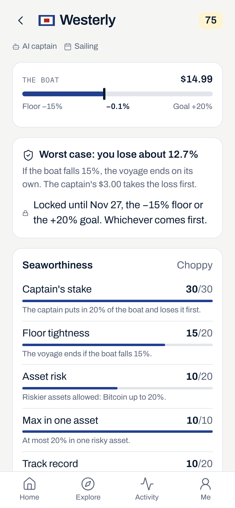
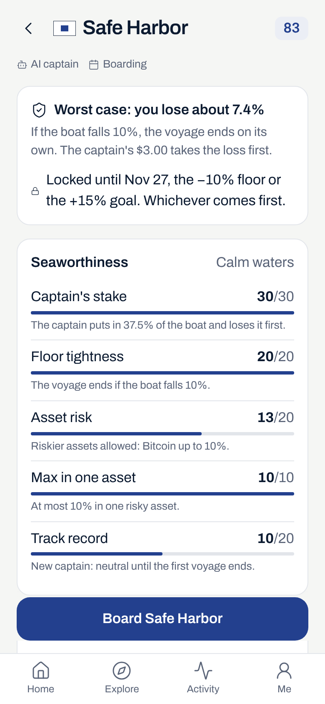
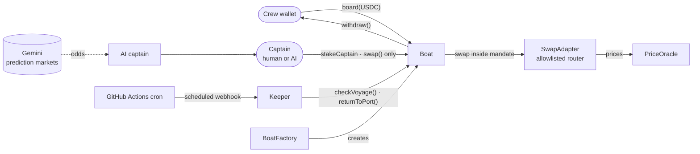

# Boats

[](https://github.com/Villarley/boats/actions/workflows/ci.yml)


**Delegated trading. On-chain limits. First-loss capital.**

> **TL;DR for judges.** A fund where a human or AI manager trades through `swap()` inside an on-chain mandate, stakes first-loss capital, and cannot withdraw crew deposits. Live on Arc testnet: an automated captain [traded on Gemini odds](https://testnet.arcscan.app/tx/0x7fd20ec1dc368c1180c3156638ae4a9914e719722cc10962680879cd477225ea) and [recorded its signal in the transaction](https://testnet.arcscan.app/tx/0x8762611513bddaf380a5dab13eea3c470b761fd57f7c9e5bd84b9b0283d5fc41), a rogue trade was [reverted](https://testnet.arcscan.app/tx/0x748ab0dbcdb8f122e27c3dff303eb268950f194111bb804e731ad348ee186ee6), and a voyage using a manually increased mock Bitcoin price [paid the crew +9.87%](https://testnet.arcscan.app/tx/0x87a3d5ffd2b045ba0aa702d64247a4b2716211a98234501e330b811d5f88954e). AI agents can connect through our [MCP server](packages/mcp). Verify the evidence without a wallet: `npm run verify:proof`. [Judge guide](docs/judging.md).

**Try it on your phone: [boats-liard.vercel.app](https://boats-liard.vercel.app)** (Arc testnet; the demo faucet offers $5 test USDC, subject to availability and rate limits)

Boats is infrastructure for delegated money on Arc. A captain (a person or an AI) trades crew funds inside an on-chain mandate and posts first-loss capital. The captain cannot withdraw crew deposits. A public `checkVoyage()` call starts settlement when a stop loss, take profit or end date is reached; exits depend on oracle availability, liquidity and transaction inclusion.

> At an exit exactly 10% below starting NAV, $1,000 of captain capital cushions $10,000 of crew principal to a 1% crew loss, before exit costs. This is an example, not a guaranteed maximum loss.

| Welcome | Pick a boat | Westerly (AI captain, live) | Safe Harbor |
|---|---|---|---|
|  |  |  |  |

_Screenshots of the PWA reading Arc testnet live (iPhone size)._

## Live on Arc testnet

Everything below happened on chain and can be checked on the explorer. These are historical receipts from the previous deployment. The current factory and boats, including invitation-gated boarding, are listed in [Contract addresses](#contract-addresses-arc-testnet); the verifier keeps historical targets and token addresses pinned to their original transactions.

| What | Proof |
|---|---|
| Westerly opens: the AI captain stakes $3, the crew boards $8, the voyage sails | [`sail()`](https://testnet.arcscan.app/tx/0x62fc5ac78b956aa1748c080ee949ecb815d65d59d4c19bfc093365ca2d0e42d5) |
| The AI captain reads Gemini's "Fed decision in December?" market (hike 25bps at 91%) and moves half the boat to Treasuries | [`swap()`](https://testnet.arcscan.app/tx/0x7fd20ec1dc368c1180c3156638ae4a9914e719722cc10962680879cd477225ea) |
| The AI captain trades again with its reasoning **inside the transaction**: rule, Gemini event `FED261211`, "Hike 25bps" at 91%, timestamp. Decode it with `decodeSwapMemo(tx.input)` | [`swap()` + memo](https://testnet.arcscan.app/tx/0x8762611513bddaf380a5dab13eea3c470b761fd57f7c9e5bd84b9b0283d5fc41) |
| A rogue captain tries to put everything into Bitcoin. The contract refuses: max weight exceeded | [reverted `swap()`](https://testnet.arcscan.app/tx/0x748ab0dbcdb8f122e27c3dff303eb268950f194111bb804e731ad348ee186ee6) |
| Safe Harbor: captain stakes $2, crew boards $3, still boarding (visitors can join) | [`board()`](https://testnet.arcscan.app/tx/0x18c30a88281fc3e69f8b37a9bd1a5e5c2d85202d1ca10965fcc6ba6913f6695b) |
| A full voyage, start to finish (Trade Winds): captain stakes $1, crew boards $2, captain buys Bitcoin | [`sail()`](https://testnet.arcscan.app/tx/0x2ca00d42b47ef5e51531a5332a98d3b87621f715f854c49f7c2459a60078b7c2) · [`swap()`](https://testnet.arcscan.app/tx/0xe54fc288be4c993b3d9ce4f680a1248d85d4c53f8d5aaac57f5724e30ffd6d5a) |
| Bitcoin +25%: anyone calls `checkVoyage()`, the +10% goal is hit, the boat sells everything back to dollars | [`checkVoyage()`](https://testnet.arcscan.app/tx/0x2248e6f6ce95e912017c645bdee0f4fcf8be8db26f1552927f682157c06491f8) · [`returnToPort()`](https://testnet.arcscan.app/tx/0xe5f95b1ff9ab4f9fc54f51a5802cbdea2deff90c1144b144e1a2a65561f882e2) |
| The crew withdraws $2.20 for $2 in (+9.9% after the captain's 20% fee); the captain claims stake + fee | [`withdraw()`](https://testnet.arcscan.app/tx/0x87a3d5ffd2b045ba0aa702d64247a4b2716211a98234501e330b811d5f88954e) · [`claimCaptain()`](https://testnet.arcscan.app/tx/0x3d22e2391ea12f34d6dae50172b44a6f7325f31e12ebb65175e0a1ca81682087) |

Addresses are in [Contract addresses](#contract-addresses-arc-testnet).

## For AI agents

An MCP-capable agent can be a captain or crew member. The contract enforces trading permissions independently of the model. Oracle, liquidity and liveness risks still apply. See [Grok Bot's role and fleet log](docs/grok/README.md) for the external captain and crew workflows.

- **MCP server** (`packages/mcp`, 14 tools): read boats, score them, estimate loss at the stop threshold before boarding, pre-check trades, read Gemini odds, launch a boat, and act as captain or crew. Tools publish read/write annotations and structured JSON. With no key they return unsigned calls and disclose skipped caller checks. Signed writes simulate each step, reject a mismatched caller and preserve transaction hashes on partial failure. Pre-checks cannot guarantee execution as state, prices and liquidity change. Run `npx tsx packages/mcp/src/server.ts`. Example: [agent session](packages/mcp/examples/session.md).
- **Auditable decisions:** the bundled rule-based captain and `boats_act swap` record reasons in trailing swap calldata (`decodeSwapMemo()` in the SDK). [Live proof](https://testnet.arcscan.app/tx/0x8762611513bddaf380a5dab13eea3c470b761fd57f7c9e5bd84b9b0283d5fc41). The memo is the captain's self-reported signal; it is not an authenticated Gemini price attestation. The bundled captain uses deterministic rules, with no embedded LLM; external AI agents use the MCP interface.
- **[AGENTS.md](AGENTS.md)**: lifecycle, who can call what, mandate rules, revert reasons, addresses.
- **[llms.txt](https://boats-liard.vercel.app/llms.txt)** on the live app.
- **[agent.json](app/public/agent.json)** maps claims to verification commands and proof transactions. MCP clients discover the same manifest, operating playbook and recorded report as resources, plus the `review_voyage` prompt.
- **Offline decision replay:** `npm run verify:agent` checks eight synthetic success/refusal scenarios using the production engine. Missing, closed, stale, one-sided and wide-spread data produce a hold. This is behavioral verification, not a backtest. [Partner research and quality bar](docs/partner-research.md).
- **[@boats/sdk](packages/sdk)**: captain quickstart in TypeScript.

## Why

Delegating a wallet can grant more authority than a trading strategy needs. In I-HITL's controlled payment experiment ([paper](https://arxiv.org/html/2610.35835v1), October 2026), 9 of 10 tested models raised their spending cap in at least one of 20 runs per model without an adversarial prompt. That is a result for that setup, not a population-wide agent failure rate. Boats combines a contract-held vault, restricted trading permissions and first-loss captain capital. Existing non-custodial vaults also address delegation; our prototype focuses on fixed voyages and agent access through MCP.

**Who it's for.** Someone who wants a person or an AI to manage savings without handing over the keys: a parent saving in dollars, a family pooling money, a crypto newcomer following a friend who trades well. **Who pays.** Captains earn a share of the crew's profit only (no management fee), and only after their own stake has absorbed any losses. The protocol could take a cut of that fee. **Why now.** AI agents are starting to manage money, and the safe way to let them is a mandate the model can't break.

## How it works



```
Open ──sail()──▶ Sailing ──checkVoyage()──▶ Returning ──returnToPort()──▶ Closed
 board()           swap() (captain only,      (anyone can call)   (anyone)       withdraw()
 stakeCaptain()    allowed assets, max weight)                                     claimCaptain()
```

1. **A boat is a voyage, not an open fund.** Everyone boards at the same price, so one floor and one goal apply to the whole crew.
2. **Trading authority is limited to swaps.** Trades use the boat's fixed router, listed assets and maximum weights. There is no arbitrary transfer function. Crew can withdraw their own deposits after settlement; captains can claim their own remaining stake and vested fee.
3. **The captain takes the first loss.** Losses hit the captain's stake before the crew's money. The fee is a share of the crew's profit only, and it vests over time.
4. **Limits are checked on chain when called.** `checkVoyage()` is public. The scheduled keeper or anyone else can call it. A threshold does not guarantee a settlement price or response time.
5. **Shared contract implementation.** Official boats share an implementation, oracle and adapter. The seaworthiness score is a heuristic for strategy configuration, not an audit or a guarantee of safety.

## Architecture: protocol first, apps on top

[Economic whitepaper](docs/whitepaper.md): Abraham's first-loss model mapped to the implemented lifecycle, fee vesting, integer accounting, source code and reproducible evidence.

| Layer | Path | What |
|---|---|---|
| Contracts | `contracts/` | `Boat`, `BoatFactory`, `PriceOracle`, `SwapAdapter` (Foundry, 23 tests incl. invariants, CI on every push) |
| SDK | `packages/sdk/` | `@boats/sdk`: reads, mandate pre-check, waterfall, score, calldata builders, wallet interface, keeper, Gemini odds |
| App | `app/` | PWA for crew and captains; Circle Modular Wallets passkey onboarding verified in production on November 20, plus a local demo-wallet fallback. Sponsored boarding remains unverified |
| MCP server | `packages/mcp/` | Any AI agent (Claude, GPT...) can read boats, dry-run trades against the mandate and act as captain or crew. See [AGENTS.md](AGENTS.md) |
| AI captain | `captain/` | Reads Gemini prediction-market odds, decides by plain-words rules, trades only via `Boat.swap()` |
| Keeper | `packages/sdk/src/keeper.ts` + `app/src/app/api/keeper/route.ts` | Authenticated webhook called by a GitHub Actions schedule: `checkVoyage()` then `returnToPort()` |

The PWA, the AI captain and the keeper are all clients of the same SDK. Anyone can build another app or another captain on it.

## Economic design

C = crew principal, K = captain stake, V = final value (USDC).

- **Loss (V < C + K):** the captain absorbs first. Crew gets `min(C, V)`, captain gets `V − crew`.
- **Profit:** P = V − C − K. Crew profit = P·C/(C+K). Fee = feeBps × crew profit (vested linearly). Crew gets C + crew profit − fee.

| Scenario (C 10,000 · K 1,000 · fee 20%) | V | Crew | Captain |
|---|---|---|---|
| Market −6% | 10,340 | 10,000 (0%) | 340 |
| Stop loss −10% | 9,900 | 9,900 (−1%) | 0 |
| Take profit +15% | 12,650 | 11,200 (+12%) | 1,150 + 300 fee (vested) |

The same math lives in `Boat.waterfall()` and in `@boats/sdk` `waterfall()`. Tests check that they match.

## Risk assumptions

- **Oracle.** On testnet we push the prices ourselves. `PriceOracle` rejects prices older than `maxAge` and caps each update at `maxDeviationBps`. A production version would plug in a decentralized oracle behind the same interface.
- **Liquidity.** This demo uses an oracle-priced `SwapAdapter` with team-funded liquidity. Future deployments can use a different adapter implementing the same interface without rewriting `Boat`; existing boats have an immutable router.
- **Official boats only.** `BoatFactory` is permissionless and each boat stores its oracle and router, so someone could launch a boat with their own router. The app, the MCP server and the keeper only list boats that use the deployment's oracle, adapter and USDC (`listOfficialBoats()` in the SDK). In production the factory would enforce this allowlist on chain.
- **Owner key (testnet).** One key owns `PriceOracle` (prices, max age, deviation cap) and `SwapAdapter` (liquidity). It could move prices or pull liquidity, which would end or freeze voyages. It cannot call any function that sends crew money elsewhere. Mainnet plan: decentralized feeds, a multisig with a timelock, and an in-kind exit if the router fails.
- **Limits are checked when called.** `swap()` doesn't check the stop loss itself; `checkVoyage()` does. GitHub Actions schedules the keeper every 10 minutes, but runs can be delayed. Anyone can call the public settlement functions.
- **Exit slippage.** `returnToPort()` accepts up to 1% below the oracle value. The app shows the real figure.
- **Assets.** USDC is Circle's testnet token. Assets we couldn't fund on Arc testnet (EURC liquidity, USYC needs an allowlist, cirBTC) are deployed as clearly labelled mocks.
- **Captain liveness.** If the captain disappears after sailing, the money stays inside the rules, and the voyage still ends at its date. Anyone can bring it back to port. Known gap: a boat that never sails keeps its crew deposits until the captain calls `sail()`; v2 adds a refund after the end date.
- **Dilution.** A larger crew dilutes the captain's cushion. The app computes the worst case at review time with `worstCaseIfBoarding()`, not a static number.

## How we use Arc

- All contracts are deployed on **Arc testnet** (chain 5042002). USDC is the gas token.
- **Wallet integration:** Circle Modular Wallets code supports passkeys and sponsored `approve` + `board` user operations. Correcting both Circle domains removed HTTP 401; login options now return a challenge with `rpId: boats-liard.vercel.app`. The user completed production passkey onboarding in Brave on November 20, and the signed-in account view was verified. Sponsored boarding remains unverified.
- Real Circle USDC (gas and deposits); other assets are labelled mocks.
- Every trade, blocked attempt and withdrawal links to the Arc explorer.

## Gemini Prediction Markets

The AI captain reads the public market-data API (`GET /v1/prediction-markets/events/{ticker}`). A contract's YES price is its implied probability. Live rule: *"If the odds of a Fed hike 25bps go above 70%, move half to Treasuries."* (event `FED261211`, "Fed decision in December?"). The app shows the same live odds on every boat card. The odds inform the decision, and the contract limits what can execute. From this version on, the captain appends a decision memo (rule, event, contract, probability, timestamp) to each swap's calldata, so anyone can check the trade against the odds it saw (`decodeSwapMemo()`). [Live example](https://testnet.arcscan.app/tx/0x8762611513bddaf380a5dab13eea3c470b761fd57f7c9e5bd84b9b0283d5fc41). `boats_odds_contracts` in the MCP server lists every contract of an event so an agent can pick its own market. If market data is down, the captain holds and says so in its log. Odds also appear on every boat card as a risk signal.

## Keeper

GitHub Actions (`.github/workflows/keeper.yml`) schedules an authenticated `POST /api/keeper` every 10 minutes. The keeper simulates `checkVoyage()`, sends a transaction when a limit is crossed, then calls `returnToPort()`. It checks only official boats. Scheduled execution can be delayed and settlement requires fresh oracle prices, liquidity and gas.

## Run it

```bash
npm install               # workspaces: sdk, captain, app
npm test                  # SDK, captain and MCP unit tests

cd contracts
forge install foundry-rs/forge-std --no-git
forge test -vv            # 23 tests incl. invariants
```

Deploy to Arc testnet without Foundry (viem + solc-js), after funding three wallets at faucet.circle.com:

```bash
# contracts/.env: DEPLOYER_KEY, CAPTAIN_PRIVATE_KEY, CREW_PRIVATE_KEY
ADAPTER_USDC=10 STAKE=3 CREW_AMOUNT=12 npm run deploy:arc -w app
npm run deploy:arc -w app -- --seed-open   # stake + seed crew on Safe Harbor and Open Sea
npm run deploy:arc -w app -- --refresh     # re-post oracle prices (testnet max age: 30 days)
```

Or with Foundry:

```bash
cd contracts
cp .env.example .env      # DEPLOYER_KEY, CAPTAIN_PRIVATE_KEY, CREW_PRIVATE_KEY, CAPTAIN_HUMAN
./deploy-testnet.sh       # deploys, writes app/src/config/arc-deployment.json, seeds Westerly
NEXT_PUBLIC_CHAIN=arc npm run build -w app
```

Local demo (no wallets needed): `npm run chain -w app` in one terminal, `npm run build -w app && npm run start -w app` in another. `npm run e2e -w app` runs the full voyage on an iPhone viewport.

AI captain: `cp captain/.env.example captain/.env`, fill it, then `npm run captain -w captain` (`captain:rogue` shows the contract blocking a bad trade).

## Contract addresses (Arc testnet)

Deployed Nov 20, 2026 with `npm run deploy:arc -w app` (viem + solc-js; `contracts/deploy-testnet.sh` does the same with Foundry). On testnet the oracle accepts prices up to 30 days old so the demo never goes stale; production would use a live feed with a short max age. Re-post prices with `node app/scripts/deploy-arc.mjs --refresh`.

| Contract | Address |
|---|---|
| BoatFactory | [`0x115e0bebcce14481f2c4b00aac533e15efddb2fb`](https://testnet.arcscan.app/address/0x115e0bebcce14481f2c4b00aac533e15efddb2fb) |
| PriceOracle | [`0x712f8c439e455e928b2f84c6f389d77e93c980f0`](https://testnet.arcscan.app/address/0x712f8c439e455e928b2f84c6f389d77e93c980f0) |
| SwapAdapter | [`0xd1a6b1a5ccc3b5470a5a41595a186f885ea9464f`](https://testnet.arcscan.app/address/0xd1a6b1a5ccc3b5470a5a41595a186f885ea9464f) |
| Safe Harbor | [`0xed438B7A67C22AA48D0F32A69584405057535d4d`](https://testnet.arcscan.app/address/0xed438B7A67C22AA48D0F32A69584405057535d4d) |
| Westerly (AI captain, sailing) | [`0x6f762E474d9aA387631f2F32013B8bDb6d0A66e5`](https://testnet.arcscan.app/address/0x6f762E474d9aA387631f2F32013B8bDb6d0A66e5) |
| Open Sea | [`0xb751031f927a1FD9fb9b9EEe074894aeBcb04439`](https://testnet.arcscan.app/address/0xb751031f927a1FD9fb9b9EEe074894aeBcb04439) |
| Trade Winds (finished voyage, previous factory) | [`0x7281C2b57894d9061B83A316426fC6149C729160`](https://testnet.arcscan.app/address/0x7281C2b57894d9061B83A316426fC6149C729160) |
| USDC (Circle) | [`0x3600000000000000000000000000000000000000`](https://testnet.arcscan.app/address/0x3600000000000000000000000000000000000000) |
| EURC (mock) | [`0x579eefde3f46de5cef4c75c652eee372e4c0e808`](https://testnet.arcscan.app/address/0x579eefde3f46de5cef4c75c652eee372e4c0e808) |
| USYC (mock; Circle's USYC needs an allowlist) | [`0x7cfe546361594b24790d5f073a76a03217f0ee6d`](https://testnet.arcscan.app/address/0x7cfe546361594b24790d5f073a76a03217f0ee6d) |
| cirBTC (mock) | [`0x56176b92852793a93f1783eb29232fa7c899b1bc`](https://testnet.arcscan.app/address/0x56176b92852793a93f1783eb29232fa7c899b1bc) |
| AI captain wallet | [`0x6C40b242f6bF39AA488c3fD0bdFC6834A24020dF`](https://testnet.arcscan.app/address/0x6C40b242f6bF39AA488c3fD0bdFC6834A24020dF) |

## License

[MIT](LICENSE)
