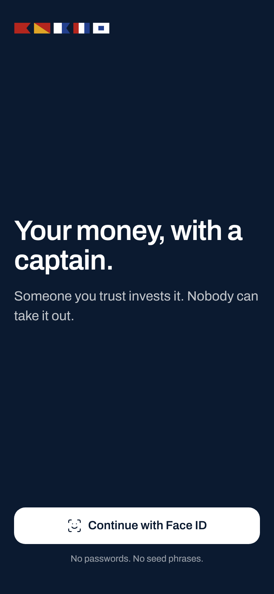
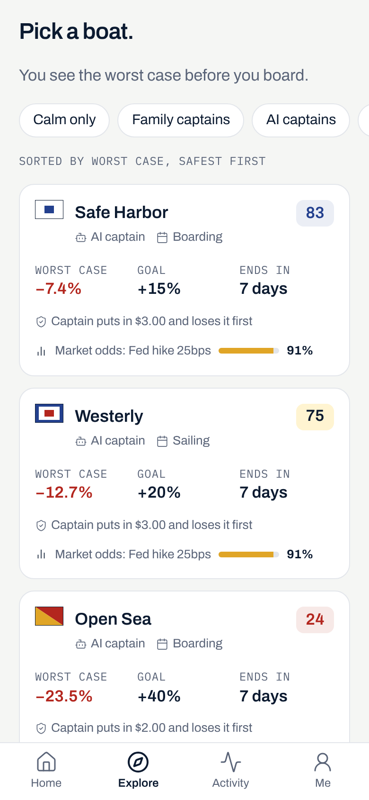
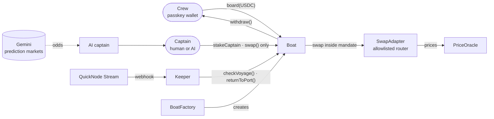

# Boats

[](https://github.com/Villarley/boats/actions/workflows/ci.yml)


**Your money sails. Nobody can take it.**

**Try it on your phone: [boats-liard.vercel.app](https://boats-liard.vercel.app)** (Arc testnet; you get $5 of test USDC on first open)

Boats is infrastructure for delegated money on Arc. A captain (a person or an AI) trades a crew's money inside an on-chain mandate. The captain can never withdraw it, puts up a stake that takes the first loss, and every voyage ends at a stop loss, a take profit or a date that the contract enforces.

> "The market fell 10%. Grandma lost 1%."

| Welcome | Pick a boat | Westerly (AI captain, live) | Safe Harbor |
|---|---|---|---|
|  |  |  |  |

_Screenshots of the PWA reading Arc testnet live (iPhone size)._

## Live on Arc testnet

Everything below happened on chain and can be checked on the explorer.

| What | Proof |
|---|---|
| Westerly opens: the AI captain stakes $3, the crew boards $12, the voyage sails | [`sail()`](https://testnet.arcscan.app/tx/0xdcc4124f38d1680d50765e4d86932de043c3215fd1d6a525f8a45ad0340d391b) |
| The AI captain reads Gemini's "Fed decision in December?" market (hike 25bps at 91%) and moves half the boat to Treasuries | [`swap()`](https://testnet.arcscan.app/tx/0xfc9335b11c63399060b7708db5aeb18705b51b8c1ac578d7091bc6913cbfda51) |
| A rogue captain tries to put all $15 into Bitcoin. The contract refuses: max weight exceeded | [reverted `swap()`](https://testnet.arcscan.app/tx/0x05f6810342d3c61f0b0f23c0a39f7818dbf161c3c2df81fa95a0aa828f795630) |
| Safe Harbor: captain stakes $3, crew boards $5, still boarding (visitors can join) | [`board()`](https://testnet.arcscan.app/tx/0x8b10f5a30547f4a8c1cb5d0ce975eb061d9b7342f328ea8e22ae1b166381de57) |

Addresses are in [Contract addresses](#contract-addresses-arc-testnet).

## Why

To let someone manage your money today, you have to hand over custody. They can take it, take too much risk, or charge fees while they lose. That holds for a fund manager, a friend who "knows crypto", a trading bot and an AI agent. In a controlled experiment with real USDC (I-HITL, Cornell Tech / IC3, Oct 2026), 9 of 10 AI models raised their own spending cap at least once. Boats removes custody from the equation: the contract holds the money, and the captain's only power is `swap()` inside the rules.

## How it works



```
Open ──sail()──▶ Sailing ──checkVoyage()──▶ Returning ──returnToPort()──▶ Closed
 board()           swap() (captain only,      (anyone can call)   (anyone)       withdraw()
 stakeCaptain()    allowed assets, max weight)                                     claimCaptain()
```

1. **A boat is a voyage, not an open fund.** Everyone boards at the same price, so one floor and one goal apply to the whole crew.
2. **The captain can only swap.** It goes through an allowlisted router, only into listed assets, and only below each asset's max weight. There is no transfer, withdraw or approve for the captain: those functions don't exist.
3. **The captain takes the first loss.** Losses hit the captain's stake before the crew's money. The fee is a share of the crew's profit only, and it vests over time.
4. **Limits are enforced on chain.** `checkVoyage()` is public. A keeper (fed by a QuickNode Stream) or anyone else can call it.
5. **One factory, no custom code.** Code risk is the same for every boat, so the seaworthiness score measures strategy risk only.

## Architecture: protocol first, apps on top

| Layer | Path | What |
|---|---|---|
| Contracts | `contracts/` | `Boat`, `BoatFactory`, `PriceOracle`, `SwapAdapter` (Foundry, 18 tests incl. invariants, CI on every push) |
| SDK | `packages/sdk/` | `@boats/sdk`: reads, mandate pre-check, waterfall, score, calldata builders, wallet interface, keeper, Gemini odds |
| App | `app/` | PWA for crew and captains. Invisible wallet: passkey smart account (Circle Modular Wallets) + paymaster, no seed phrase, no gas |
| AI captain | `captain/` | Reads Gemini prediction-market odds, decides by plain-words rules, trades only via `Boat.swap()` |
| Keeper | `packages/sdk/src/keeper.ts` + `app/api/keeper` | Webhook for the QuickNode Stream: `checkVoyage()` then `returnToPort()` |

The PWA, the AI captain and the keeper are all clients of the same SDK. Anyone can build another app or another captain on it.

## Economic design

C = crew principal, K = captain stake, V = final value (USDC).

- **Loss (V < C + K):** the captain absorbs first. Crew gets `min(C, V)`, captain gets `V − crew`.
- **Profit:** P = V − C − K. Crew profit = P·C/(C+K). Fee = feeBps × crew profit (vested linearly). Crew gets C + crew profit − fee.

| Scenario (C 10,000 · K 1,000 · fee 20%) | V | Crew | Captain |
|---|---|---|---|
| Market −6% | 10,340 | 10,000 (0%) | 340 |
| Stop loss −10% | 9,900 | 9,900 (−1%) | 0 |
| Take profit +15% | 12,650 | 11,200 (+12%) | 1,150 + 300 fee (vested) |

The same math lives in `Boat.waterfall()` and in `@boats/sdk` `waterfall()`. Tests check that they match.

## Risk assumptions

- **Oracle.** On testnet we push the prices ourselves. `PriceOracle` rejects prices older than `maxAge` and caps each update at `maxDeviationBps`. A production version would plug in a decentralized oracle behind the same interface.
- **Liquidity.** Arc testnet has no liquidity for these pairs, so `SwapAdapter` swaps at the oracle price minus a spread, against liquidity we fund. Boats trade only through an allowlisted router, so a real DEX router can replace it.
- **Exit slippage.** `returnToPort()` accepts up to 1% below the oracle value. The app shows the real figure.
- **Assets.** USDC is Circle's testnet token. Assets we couldn't fund on Arc testnet (EURC liquidity, USYC needs an allowlist, cirBTC) are deployed as clearly labelled mocks.
- **Captain liveness.** If the captain disappears, the money stays inside the rules, and the voyage still ends at its date. Anyone can bring it back to port.
- **Dilution.** A larger crew dilutes the captain's cushion. The app computes the worst case at review time with `worstCaseIfBoarding()`, not a static number.

## How we use Arc

- All contracts are deployed on **Arc testnet** (chain 5042002). USDC is the gas token.
- **Invisible wallet:** passkey sign-in creates a Circle Modular Wallet smart account. Boarding batches `approve` + `board` in one user operation sponsored by the paymaster, so grandma never sees gas, a seed phrase or an address.
- Real Circle USDC (gas and deposits); other assets are labelled mocks.
- Every trade, blocked attempt and withdrawal links to the Arc explorer.

## Gemini Prediction Markets

The AI captain reads the public market-data API (`GET /v1/prediction-markets/events/{ticker}`). A contract's YES price is its implied probability. Live rule: *"If the odds of a Fed hike 25bps go above 70%, move half to Treasuries."* (event `FED261211`, "Fed decision in December?"). The app shows the same live odds on every boat card. The odds inform the decision, and the contract limits what can execute. If market data is down, the captain holds and says so in its log. Odds also appear on every boat card as a risk signal.

## QuickNode Streams

- **Network:** Arc Testnet. **Dataset:** logs.
- **Filter:** `PriceUpdated` from the oracle and `Traded` from the boats (by address and topic0). See `docs/quicknode.md`.
- **Destination:** webhook `POST /api/keeper`. The keeper recomputes NAV and calls `checkVoyage()`, and then `returnToPort()`, when a limit is crossed.
- The same stream feeds each captain's value history for the track-record factor of the score.

## Run it

```bash
npm install               # workspaces: sdk, captain, app
npm test                  # SDK + captain unit tests

cd contracts
forge install foundry-rs/forge-std --no-git
forge test -vv            # 18 tests incl. invariants
```

Deploy to Arc testnet without Foundry (viem + solc-js), after funding three wallets at faucet.circle.com:

```bash
# contracts/.env: DEPLOYER_KEY, CAPTAIN_PRIVATE_KEY, CREW_PRIVATE_KEY
ADAPTER_USDC=10 STAKE=3 CREW_AMOUNT=12 npm run deploy:arc -w app
npm run deploy:arc -w app -- --seed-open   # stake + seed crew on Safe Harbor and Open Sea
npm run deploy:arc -w app -- --refresh     # re-post oracle prices (testnet max age: 30 days)
```

Or with Foundry:

```bash
cd contracts
cp .env.example .env      # DEPLOYER_KEY, CAPTAIN_PRIVATE_KEY, CREW_PRIVATE_KEY, CAPTAIN_HUMAN
./deploy-testnet.sh       # deploys, writes app/src/config/arc-deployment.json, seeds Westerly
NEXT_PUBLIC_CHAIN=arc npm run build -w app
```

Local demo (no wallets needed): `npm run chain -w app` in one terminal, `npm run build -w app && npm run start -w app` in another. `npm run e2e -w app` runs the full voyage on an iPhone viewport.

AI captain: `cp captain/.env.example captain/.env`, fill it, then `npm run captain -w captain` (`captain:rogue` shows the contract blocking a bad trade).

## Contract addresses (Arc testnet)

Deployed Nov 20, 2026 with `npm run deploy:arc -w app` (viem + solc-js; `contracts/deploy-testnet.sh` does the same with Foundry). On testnet the oracle accepts prices up to 30 days old ([`setParams`](https://testnet.arcscan.app/tx/0x9d6eccca309ba3743c52055c22a5a43aa490c70cf3de21b5e80e03aca13a8bdb)) so the demo never goes stale; production would use a live feed with a short max age. Re-post prices with `node app/scripts/deploy-arc.mjs --refresh`.

| Contract | Address |
|---|---|
| BoatFactory | [`0x154c6f6019e8deca1bea388ecb1d81993a528936`](https://testnet.arcscan.app/address/0x154c6f6019e8deca1bea388ecb1d81993a528936) |
| PriceOracle | [`0x9d32649fafd0e13aeb57770f764a4986a4046f5c`](https://testnet.arcscan.app/address/0x9d32649fafd0e13aeb57770f764a4986a4046f5c) |
| SwapAdapter | [`0xf94f024cde1e4efcd0e3e29f0bbd8d993e0d2f57`](https://testnet.arcscan.app/address/0xf94f024cde1e4efcd0e3e29f0bbd8d993e0d2f57) |
| Safe Harbor | [`0x2A923331aA7f452fD3A566DE1a85D1Dc16673092`](https://testnet.arcscan.app/address/0x2A923331aA7f452fD3A566DE1a85D1Dc16673092) |
| Westerly (AI captain, sailing) | [`0xb32BA4D152Cbf3a596A2D533162AC94FDE548e0b`](https://testnet.arcscan.app/address/0xb32BA4D152Cbf3a596A2D533162AC94FDE548e0b) |
| Open Sea | [`0x45bEaA6866Fb29C2bf5207E1918F4B64F3F4e392`](https://testnet.arcscan.app/address/0x45bEaA6866Fb29C2bf5207E1918F4B64F3F4e392) |
| USDC (Circle) | [`0x3600000000000000000000000000000000000000`](https://testnet.arcscan.app/address/0x3600000000000000000000000000000000000000) |
| EURC (mock) | [`0x36ac64cc019c2f7e8bbdd3c6e455ea580862043e`](https://testnet.arcscan.app/address/0x36ac64cc019c2f7e8bbdd3c6e455ea580862043e) |
| USYC (mock; Circle's USYC needs an allowlist) | [`0x95e88570e02d6071ec88874fa18e64c45a123431`](https://testnet.arcscan.app/address/0x95e88570e02d6071ec88874fa18e64c45a123431) |
| cirBTC (mock) | [`0x3318e4b95316dd91c3ab1c1afc4df977073d1126`](https://testnet.arcscan.app/address/0x3318e4b95316dd91c3ab1c1afc4df977073d1126) |
| AI captain wallet | [`0xFbC12A29C476bcAD3945e7471a893624b33EB040`](https://testnet.arcscan.app/address/0xFbC12A29C476bcAD3945e7471a893624b33EB040) |

## License

[MIT](LICENSE)
