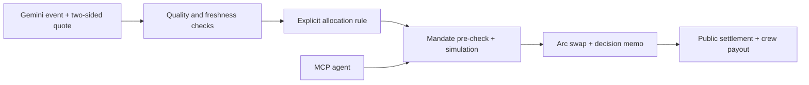

# Boats: partner research and submission strategy

Reviewed November 20, 2026. The decisions below are our interpretation of public sponsor recaps and project evidence. They set a quality bar for this submission; they are not official judging scores.

## What the same partners have rewarded

| Partner / event | Evidence | Decision for Boats |
|---|---|---|
| Arc / Circle, HackMoney 2026 | Sponsor reports **155 submissions**, **97%** with experimental agents and **56%** with crosschain functionality. Named winners include arctan(x), Text-to-Chain, ArcFlow and Versus. Technical execution, utility and integration quality were explicit evaluation factors. [Official recap, April 2](https://www.arc.io/blog/meet-the-arc-track-winners-from-the-hackmoney-2026-hackathon-and-what-we-learned) | “AI agent” is a crowded category. Lead with the enforceable mandate, first-loss stake and completed settlement. Show what Arc actually settles. |
| Arc / Circle, ETHGlobal Cannes 2026 | Sponsor reports **69 teams / 142 builders** and **98%** agentic applications. PayMate and C.E.S.T.A Agent demonstrate agents coordinating pooled capital; Onda and NanoCrawl make settlement essential to the product. [Official recap, April 27](https://www.arc.io/blog/meet-the-arc-track-winners-from-ethglobal-cannes-hackathon-and-what-we-learned) | Demonstrate a complete economic flow: pool → decision → permitted trade → payout. Each integration should earn its place in that flow. |
| Gemini Prediction Markets, Penn Blockchain Hackathon | Pollux builder Justin Li reports a Gemini bounty win and second overall for a prediction-market terminal emphasizing order books, spreads and calibration. This award is a **builder report**, not independently confirmed organizer results. [Builder account](https://www.linkedin.com/posts/justinli500_our-project-pollux-won-the-gemini-prediction-activity-7453472893600034817-K-mW) | Treat signal quality as part of execution: retain bid/ask, reject closed markets, and hold on one-sided or wide quotes. Do not imply a probability is a calibrated forecast or proven trading edge. |
| Quicknode, Build On 2024 | **1,800+ applications / 110+ projects**. Overall winner Quicknode for Robotics combined Functions and Streams; Gas Guardian won Streams. [Official recap, December 2](https://www.quicknode.com/blog/build-on-hackathon-by-the-numbers) | A configured event pipeline must do useful work. Boats has no configured Streams delivery, so that bounty is outside this submission. |

The Arc Cannes recap gives inconsistent winner counts; we do not use its winner/adoption ratio. These samples describe their events, not all hackathons. Google Gemini model prizes and Gemini Exchange Prediction Markets are different programs; Boats targets the latter.

## The coherent story

**Boats gives delegated capital an enforceable trading mandate and a captain who loses first.**

For a small group pooling test USDC, an agent can observe a macro signal and rebalance only within agreed asset caps. Gemini supplies the market observation. The captain proposes an action. Arc executes the mandate and settlement. MCP gives another agent access to the same protocol with inspectable plans and results. First-loss capital connects authority to economic responsibility.

Use the existing memo-bearing swap, failed overweight trade and completed voyage as three demonstrations. They belong to **two boats** and different transactions; do not splice them into a fictional single voyage. The historical memo predates the new quote-quality gate. The gate is verified by current tests and synthetic replay, not retroactively proven by that memo.

## Evidence by area

| Part | What a judge can verify | Boats evidence |
|---|---|---|
| Problem | Name the delegated authority and who bears loss | Fixed mandate + captain first-loss example; focus on small groups, not every financial use case |
| DeFi mechanism | Explain deposits, trading permission, loss waterfall, fee and exit | Contract tests, [economic design](../README.md#economic-design), completed payout |
| Arc | Show essential deployed settlement rather than a logo | Chain 5042002 addresses, receipts and `npm run verify:proof` |
| Gemini | Show the exact market, action rule, quality checks and resulting decision | `FED261211` → threshold → memo; `npm run verify:agent` for failure cases |
| Agent readiness | A new agent can discover, review, plan and recover without a private key | 14 tools, 3 resources, `review_voyage`, structured results and returned hashes |
| Reliability | Demonstrate refusal as well as success | Eight offline cases plus historical on-chain max-weight rejection |
| Evidence | Every material claim points to source, command or transaction | [agent.json](../app/public/agent.json), [recorded report](evidence-report.json), read-only verifier |
| Presentation | One story in 2–3 minutes, with actual sponsor use visible | [2:45 demo script](devpost.md#demo-video-script-245), connecting the mandate, decision memo, rejected trade and settlement proofs |

Production passkey onboarding is verified. The prototype's technical boundaries remain explicit: team-controlled oracle and liquidity, unaudited contracts, and no refund path for a boat that never sails.

## Design rationale

- **Why an on-chain mandate?** Agent instructions and off-chain checks can fail. A transaction that violates the contract's asset cap reverts independently of the proposer.
- **Why first loss?** The captain contributes capital before sailing; losses consume that stake before crew principal. It is a cushion, not insurance.
- **Why Gemini?** An external market observation triggers an explicit allocation rule. Removing it removes the bundled captain's demonstrated signal, while manual/MCP operation remains possible.
- **Why Arc?** The vault, USDC accounting, gas and final payout run on the same testnet settlement layer. Crosschain movement is not implemented or claimed.
- **Where is the AI?** The bundled captain is deterministic; external LLM agents use MCP. The protocol constrains both. No trading alpha or embedded LLM is claimed.
- **What is mocked?** EURC, USYC, cirBTC, oracle prices and adapter liquidity. The controlled +9.8701% payout validates settlement accounting, not real yield.
